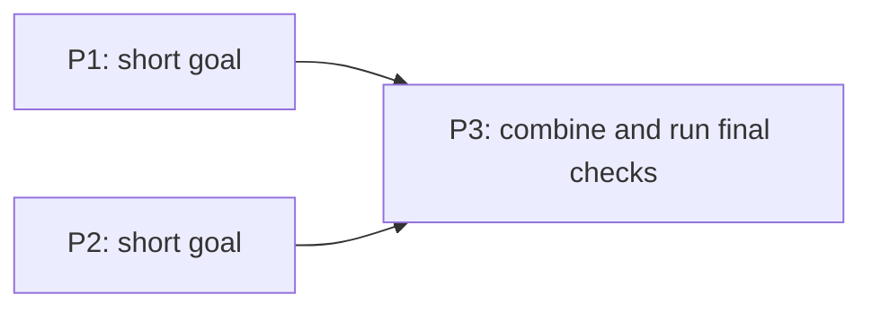

# Plan Quality

## Overview

Use this skill to turn a request into a small, executable implementation plan that people can read quickly. It defines scope and non-scope, identifies meaningful prerequisites and dependencies, specifies observable verification, explains the change in plain words with a small diagram, and ends with a task-specific execution checklist. It supports creating, reviewing, refining, and learning from plans.

A good plan is the **shortest** document that tells an implementer what to change, what not to touch, and how to prove it works, in words the person approving it can follow without reading the code. Length, phase count, and jargon are costs, not signals of quality.

This skill is workflow-agnostic. Do not assume any specific delivery system, issue tracker, CI setup, or retrospective format.

## The default plan is one phase

Start every plan as a single cohesive change with no phase identifiers. Add a second phase only when it passes the justification test in `references/PLAN_QUALITY_CHECKLIST.md`. Most tasks — including most multi-file refactors and feature additions — are one phase.

Rough calibration:

| Work | Expected phases |
| --- | --- |
| Any change one person can implement and verify in one sitting | 1 |
| Independent workstreams that can genuinely run concurrently | 1 per stream + 1 integration |
| Ordered migration/deploy with separately reversible steps | 1 per reversible step |

If a plan exceeds 3 phases, treat that as a defect until each phase is individually justified.

## Workflow

1. Read the request, repo context, and any existing plan.
2. Read `references/PLAN_WRITING_GUIDE.md`, then draft the plan as **one** change in plain words: scope, what must not change, done-when evidence.
3. Read `references/PLAN_QUALITY_CHECKLIST.md` and pull in only the sections that reduce real ambiguity for this task. Only when a plan adds or alters an external contract or durable data shape, require explicit contract/state-shape, data-classification, and read-back evidence. Always apply its scope test to planned features, edge cases, and future-proofing, removing unrequested scope while preserving explicitly requested or approved behavior.
4. Only if the work truly has separable units: split, and write one justification line per phase.
5. Classify unknowns instead of guessing: decisions needed before execution are blockers; everything else is a recorded assumption or follow-up.
6. Add one small diagram to the Overview unless the change is trivial; when phases run in parallel, also draw the phase order.
7. End with a task-specific `Execution checklist`: one short checkbox per phase (so usually one checkbox).
8. Reread the Overview, diagram, and Change section as the approver would, and rewrite anything they could not follow without opening the code.

## Output contract

- Every generated plan starts with a concise `## Overview` section before `## Change` or `## Phases`. Its text is 1–3 plain sentences covering the problem or goal, what changes, and the intended outcome; the diagram, when there is one, comes right after. Keep detailed scope, prerequisites, and verification in the sections that follow.
- Write for a reader who knows the product but not this code, following `references/PLAN_WRITING_GUIDE.md`: everyday words, one idea per bullet, any needed technical term explained once, and implementer details such as file paths and commands after the Change section.
- Include one small Mermaid diagram in the Overview unless the change is trivial, such as a one-line fix. When phases run in parallel, also draw the phase order under `## Parallelization`. Diagrams illustrate the text and never add scope.
- Scope, out-of-scope, and observable done-when evidence are always present.
- Phase identifiers, `Depends on`, `Produces`, handoffs, waves, and join gates appear **only** in genuinely multi-phase plans. Never write `Depends on: none` for a single-unit plan.
- Each phase in a multi-phase plan carries a one-line `Why separate:` reason that states, in plain words, which checklist phase test (a–d) it meets, for example "runs in parallel with P2; they share no files". A bare letter is not a reason.
- A `Parallelization` line is required only when there is more than one phase; state which phases run concurrently, or that execution is sequential and why.
- The plan ends with an `Execution checklist` (or clearly equivalent heading), one checkbox per phase. Each checkbox states the phase's outcome in one short plain line; the details stay in Done when. Do not create checkboxes for individual work items inside a phase, and do not copy the canonical checklist into the plan.

Default shape — use this unless the justification test forces more:

````md
## Overview
<1–3 plain sentences: the problem or goal, what changes, and the outcome>


_Highlighted: <what is new or changed>._

## Change
- Scope: <the one change, in plain words, and where it stops>
- Not changing: <what must stay exactly as it is, user-visible behavior first>
- Done when: <what to run or look at that proves it works>

## Implementation notes
- <files, entry points, commands, prerequisites, or checks the implementer needs that are not obvious>

## Execution checklist
- [ ] <the outcome in one short line>, and the Done-when checks pass.
````

Multi-phase shape — only when each phase passes the test. Keep it this terse:

````md
## Overview
<1–3 plain sentences: the problem or goal, what changes, and the outcome>

<diagram of the change, as in the default shape>

## Phases

### P1: <goal>
- Why separate: runs in parallel with P2; they share no files.
- Changes: <files or areas>
- Produces: <the file, result, or decision P3 uses>
- Done when: <what proves P1 works>

### P2: <goal>
- Why separate: runs in parallel with P1; they share no files.
- Changes: <other files or areas>
- Done when: <what proves P2 works>

### P3: <integration goal>
- Depends on: P1, P2
- Why separate: the combined result must pass its own review before release.
- Done when: <what proves the combined change works>

## Parallelization
- P1 and P2 run in parallel because they share no files; P3 starts after both pass their Done-when checks.



## Execution checklist
- [ ] P1: <outcome in one short line>.
- [ ] P2: <outcome in one short line>.
- [ ] P3: <combined outcome>, and the final checks pass.
````

## Plan review output

When reviewing a plan, lead with what to cut:

- Phases that fail the justification test, and the merge target for each
- Sections that are boilerplate rather than task-specific decisions
- Scope that should be cut because it was never requested or approved, versus scope that must stay because it was explicitly requested or previously approved
- Missing overview, scope boundaries, done-when evidence, or real dependencies
- Unsafe parallelization assumptions
- Whether the execution checklist is followable without inventing decisions
- For plans adding or altering an external contract or durable data shape: check implicit contracts, durable-state shape, data classification, and read-back evidence
- Readability problems the approver would trip on: jargon, run-on bullets or checkboxes, implementer detail ahead of the summary, or a missing or confusing diagram (see `references/PLAN_WRITING_GUIDE.md`)
- Open questions needing user/product judgment, and items safe to defer

Prefer short, task-specific bullets. Do not add sections the approver or a competent implementer would not need.

## Post-execution improvement feedback

When execution, review, debugging, or user feedback reveals a planning gap, add:

```md
## Plan quality improvement suggestions

- Classification: shared-skill candidate | repo-specific guidance | task-specific note only
- Checklist area: scope | prerequisites | verification | isolation | validation | completeness | phase split | parallelization | readability | post-execution learning
- Suggested addition: <concise checklist wording>
- Why it generalizes: <one sentence>
```

Only include suggestions that would have materially improved this plan. Do not invent process changes to fill the section.

## Updating the skill

Do not assume the skill repository is writable; it is often installed from a shared source.

If the user asks to improve the skill and the repo is writable, edit the matching reference, `references/PLAN_QUALITY_CHECKLIST.md` for what a plan covers or `references/PLAN_WRITING_GUIDE.md` for how it reads, and keep `SKILL.md` focused on workflow. Otherwise offer PR-ready wording, an issue draft, or repo-specific guidance instead.

Prefer shared-reference changes only for broadly reusable lessons. Keep repo-specific rules in that repo's docs and one-off notes in the plan. When adding to either reference, consider what to delete: growth is the main failure mode of this skill.
