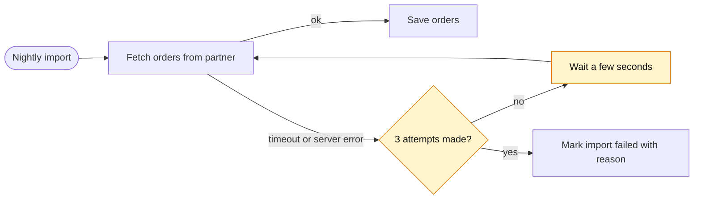

# Plan Writing Guide

`PLAN_QUALITY_CHECKLIST.md` decides what a plan covers. This guide decides how it reads, and it applies to every plan. The goal is a plan that is quick to read, not one free of technical words. Plain writing should make a plan shorter, not longer.

## Write for two readers

- **The approver** is an engineer who knows the product and the goal, but not this code. They read the top of the plan to decide whether to go ahead.
- **The implementer**, a person or an agent, needs exact names, paths, and commands.

Write the Overview, the diagram, and the Change section for the approver. Put file paths, function names, commands, and links after the Change section, or at the end of the bullet that needs them.

## Use plain words

- Start with what a user or operator will notice, then explain how it works.
- Put one idea in each bullet. Keep sentences short: about 25 words at most.
- Common engineering terms are fine: API, retry, timeout, cache, HTTP 429, idempotent, migration. Explain project-specific names and uncommon acronyms in a few words the first time.
- Describe a concrete case instead of a category: "if the export command crashes after writing its file", not "on post-export rendering failure".
- Avoid slash chains such as `auth/permission/usage` and long comma lists. Name the few items at real risk, or group the rest in plain words.
- For what must not change, start with the user's view ("links, logins, and error messages work as today"), then name the specific items at risk.
- Readability suffers most from dense, abstract process wording. Replace it with the concrete thing:

| Instead of | Write |
| --- | --- |
| gate, completion gate | a check that must pass before … |
| evidence, observable verification | how we will know it works: what to run or look at |
| contract | what other code or people rely on, named: the API fields, the file format |
| owner of a behavior | the one place in the code that handles it |
| consumer, consumer path | who uses it and how: the page, the caller, the command |
| artifact, handoff | the file or result the next step uses |
| boundary, surface | the files, pages, or APIs affected |
| durable, read-back | saved; read the saved data back |
| bounded | the actual limit: at most N tries, or N seconds |

## Add a diagram

Include one small Mermaid diagram in the Overview, right after its sentences. GitHub and GitLab render Mermaid, and the source still reads well as plain text. Skip the diagram only for a trivial change, such as a one-line fix or a wording change, where a picture would repeat the Overview.

Pick the diagram that fits the change:

| If the plan… | Draw | Mermaid type |
| --- | --- | --- |
| adds steps or branches to a process, such as a retry, a fallback, or an error path | the flow, with the new steps highlighted | `flowchart` |
| changes how parts call each other | the calls, in order | `sequenceDiagram` |
| moves code or responsibility between parts | before and after, side by side | `flowchart` with two `subgraph` blocks |
| changes the states something moves through | the states and the moves between them | `stateDiagram-v2` |
| has phases that run in parallel | the phase order: what runs together and where it joins | `flowchart` |

Keep it easy to read:

- Show only the few steps or parts needed to explain the change, about 10 at most, not the whole system.
- Use short, plain labels such as "Fetch orders", not function signatures. Use a code name only when the reader will search for it.
- Mark new or changed steps where that helps, and explain the marking in a one-line caption.
- One diagram is usual. Use two at most, for example the change plus the phase order.
- The diagram illustrates the text. Everything it shows must also be in the text, and it must not add scope.
- Keep the syntax simple so it renders: quote labels that contain punctuation, as in `A["Retry (max 3)"]`; indent each line; never name a box `end`; avoid HTML. Preview the diagram when a renderer is available.

## Example

Dense, hard to follow:

> Make partner ingestion resilient to transient upstream failures via bounded retries in the fetch owner, preserving truthful job status on exhaustion.
>
> - [ ] Implement bounded fetch retry in the ingestion owner, prove exhaustion semantics and status truthfulness, and pass regression gates.

Plain, with a diagram:

````md
## Overview

The nightly order import fails whenever the partner API has a brief hiccup, so orders show up a day late. For a timeout or server error, this change makes at most 3 attempts in total, waiting a few seconds between them. If every attempt fails, the import is marked failed with the reason, as it is today.



_Highlighted: the new retry steps._

## Change
- Scope: for a timeout or server error, make at most 3 attempts in total, waiting a few seconds between them.
- Not changing: which orders are saved, the import schedule, and how a failed import is reported.
- Done when: a test where the partner fails twice and then succeeds saves every order, and a test where it always fails marks the import failed after exactly 3 attempts.

## Implementation notes
- The retry belongs in `PartnerClient.fetchOrders`; reuse its existing timeout setting.

## Execution checklist
- [ ] The import makes up to 3 attempts on partner timeouts or server errors, and the Done-when tests pass.
````
